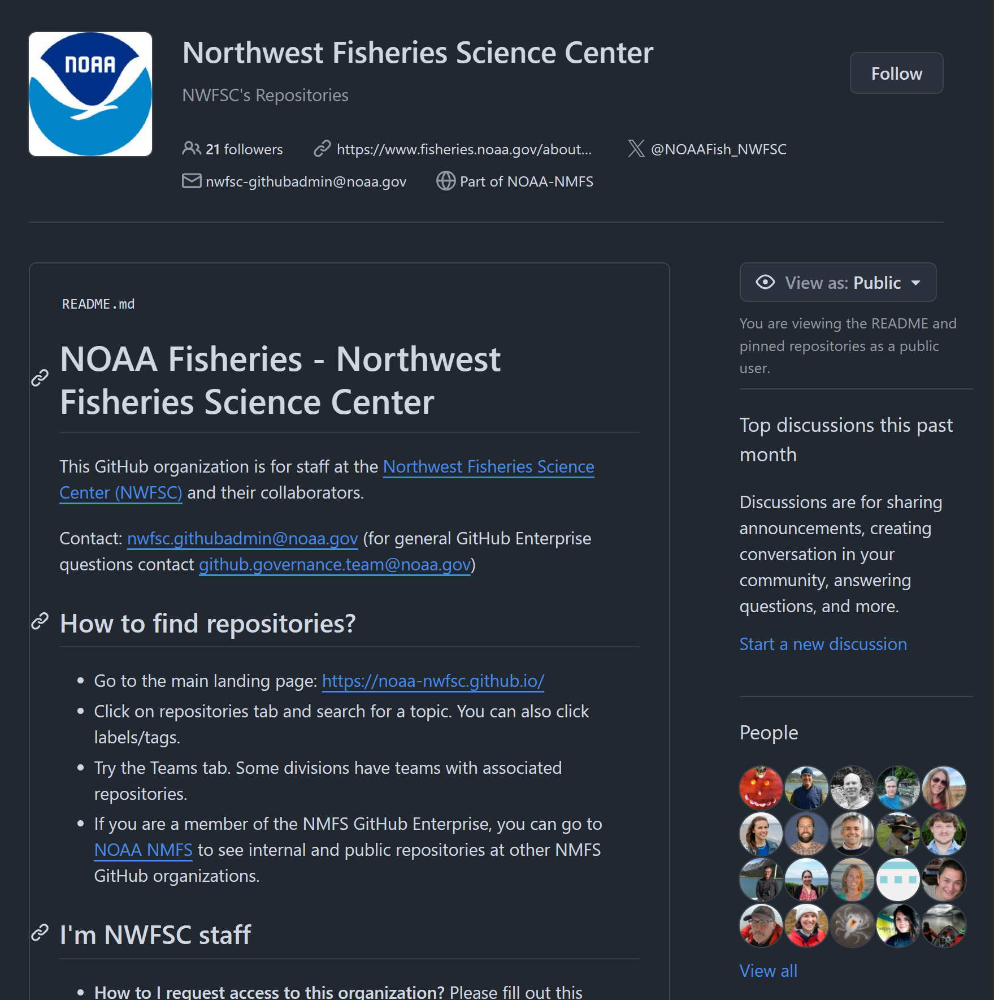
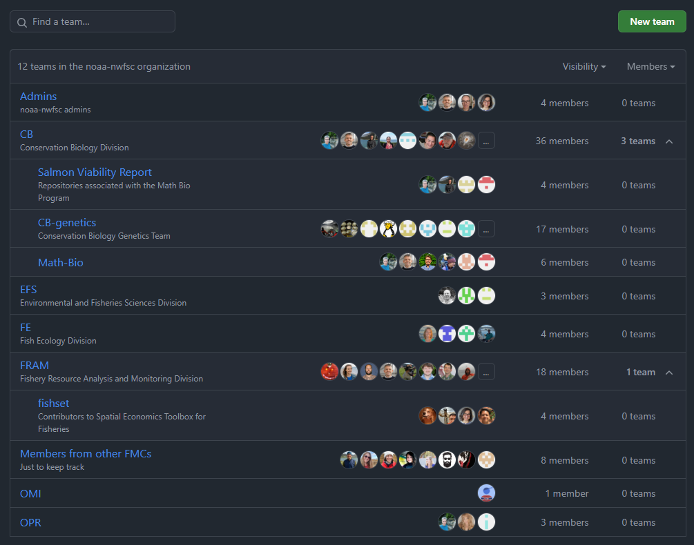
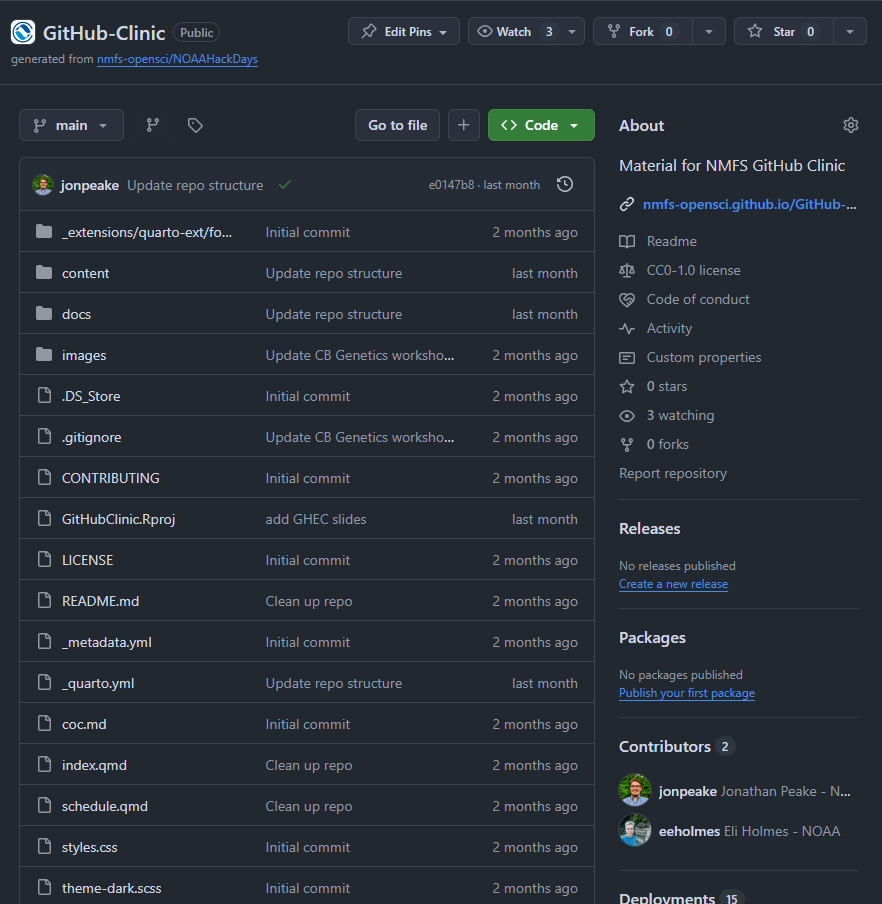
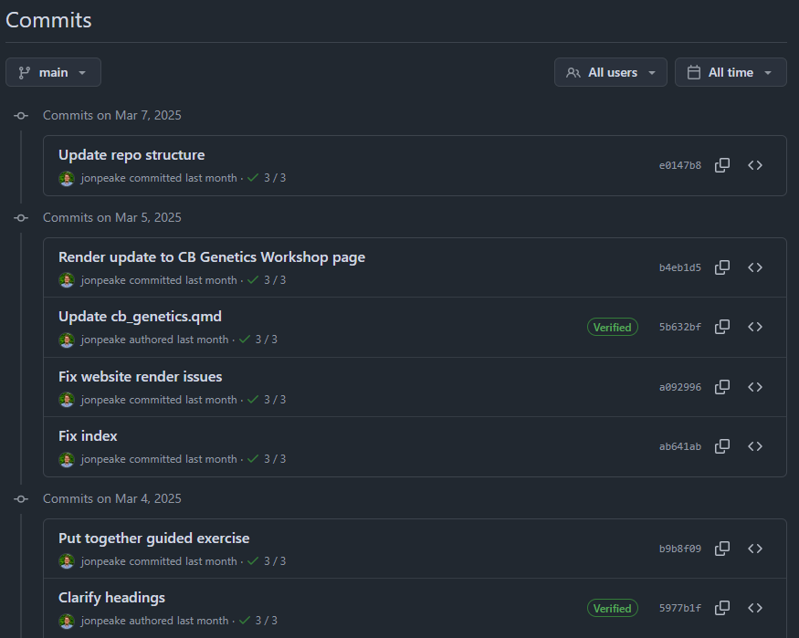

## Users, organizations, and teams

::::: columns
::: {.column width="60%" layout="[[-1], [1], [-1]]"}
### Users

- Your account

- Connected to your NOAA email

- Can add secondary email

### 
:::

::: {.column width="40%"}

:::
:::::

## Users, organizations, and teams

::::: columns
::: {.column width="50%" layout="[[-1], [1], [-1]]"}
### Organizations

- Shared account with large number of people

- Can be housed under Enterprise

- Collaboration and controlled access
:::

::: {.column width="50%"}

:::
:::::

## Users, organizations, and teams

::::: columns
::: {.column width="50%" layout="[[-1], [1], [-1]]"}
### Teams

- Nested within organization

- Sub-groups for collaboration and access

- Can have teams within teams for more fine-scale structure
:::

::: {.column width="50%"}

:::
:::::

## Repositories - the main unit

::::: columns
::: column
- Sets the folder and file structure

- Contained and permissioned

- Public, private, or internal (Enterprise)

- Commits and issues - Contributing through GitHub
:::

::: column

:::
:::::

## Commit

::::: columns
::: column
- A specific "thing" that you want to save and keep a record for

- Snapshot of all the files in the entire project

- Commit messages provide info about the "thing" you've done

- Commits give a history of the project
:::

::: column

:::
:::::

## Projects

- Adaptable, flexible tool for planning and tracking work on GitHub

- Spreadsheet, task-board, and roadmap integrated with issues and pull requests

- Provide multiple views by filtering, sorting, grouping issues/PRs

- Visualize work with configurable charts

- Add custom fields to track team-specific metadata